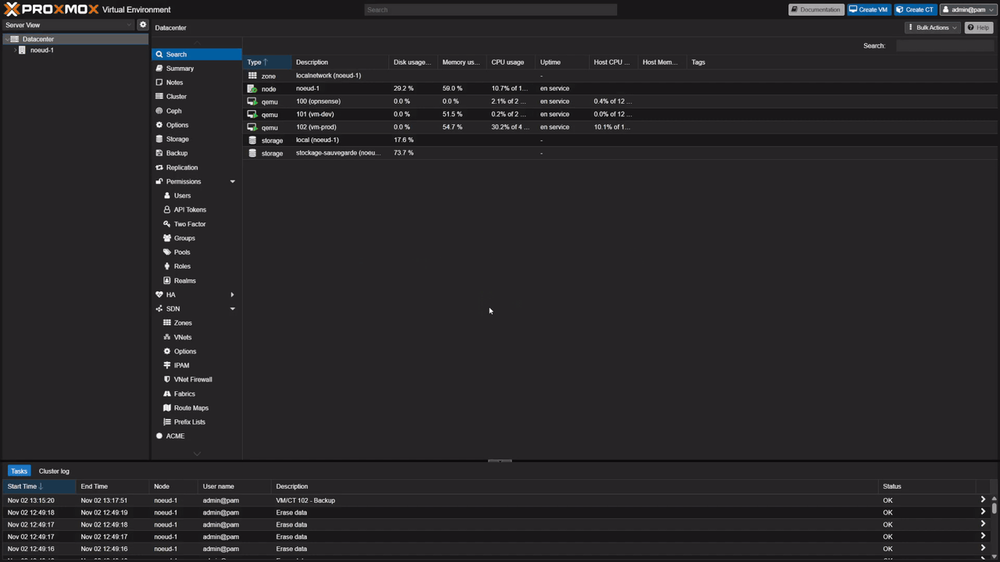
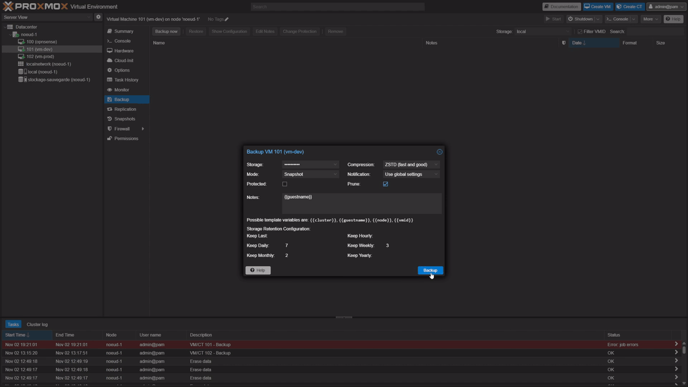
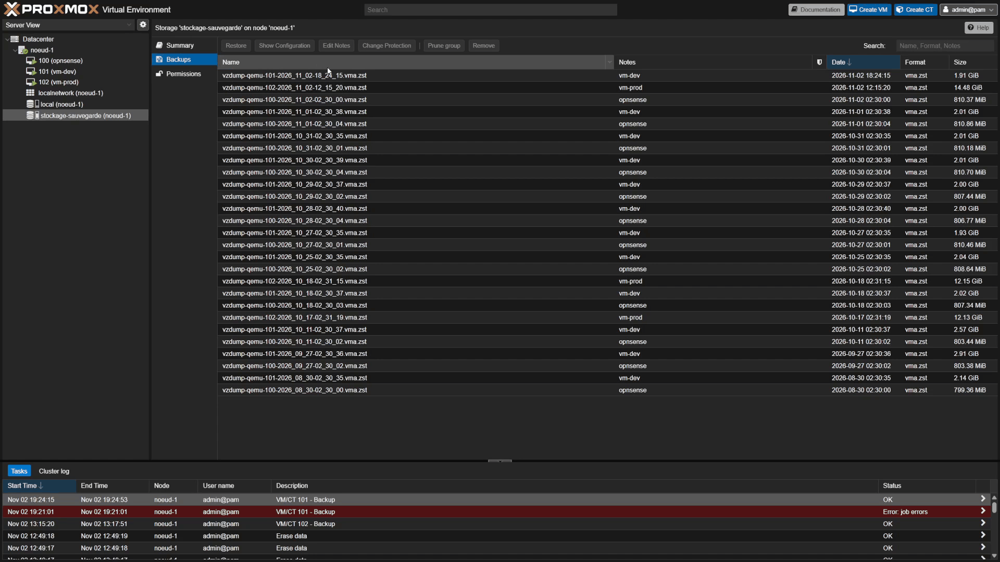
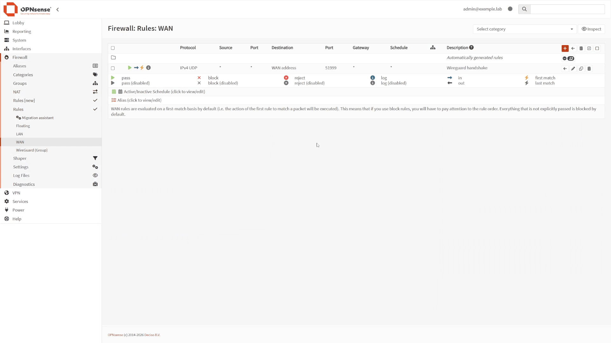
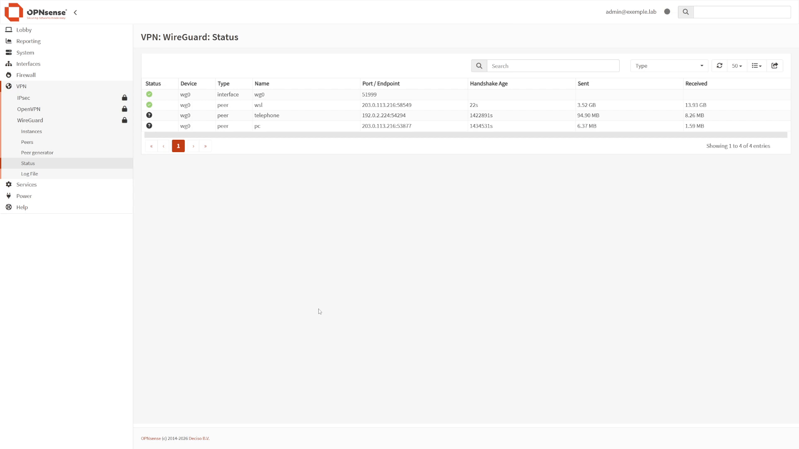
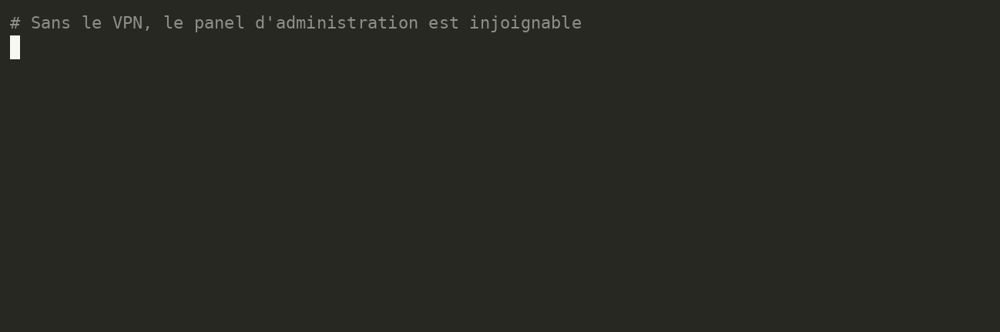
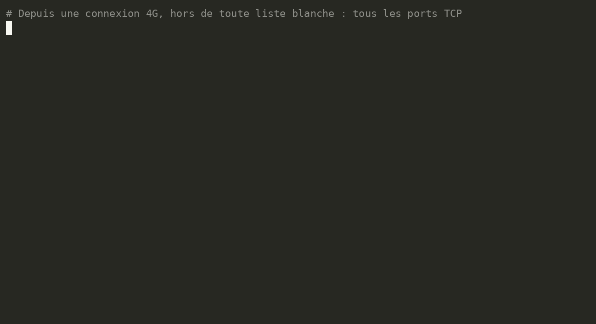
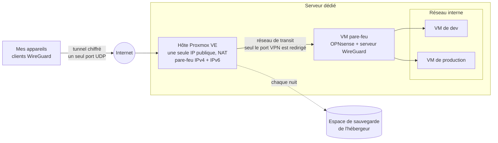

# Homelab : un labo de dev sur serveur dédié, joignable de partout

Un serveur dédié chez OVH, découpé en machines virtuelles, protégé par deux pare-feu et
accessible uniquement par VPN. Je l'ai conçu, installé, durci et documenté moi-même, en
m'appuyant sur des tutoriels de référence et sur Claude comme tuteur (voir
[Sources et outils](#sources-et-outils)). C'est mon environnement de développement, et surtout
mon terrain de jeu : j'y crée des VM pour tester, je peux tout casser sans risque, puis tout
restaurer. Il fait aussi tourner, chaque nuit, mes chaînes de production vidéo automatisées.

> **Vitrine publique.** Le dépôt de travail (documentation complète, journal de chaque commande
> exécutée) reste privé. Ici, ni adresse, ni port, ni nom de machine : tout ce qui pourrait
> servir à atteindre l'infrastructure a été retiré ou remplacé par des valeurs fictives.
> Comment, sans rien laisser passer : [les coulisses de cette vitrine](docs/coulisses.md).

## En bref

- **Hyperviseur** : Proxmox VE sur un serveur dédié (6 cœurs, 32 Go de RAM, SSD en RAID).
- **Pare-feu** : OPNsense, en machine virtuelle, devant tout le réseau interne. L'hôte a aussi
  son propre pare-feu, en IPv4 et en IPv6.
- **Accès** : uniquement par VPN WireGuard. Depuis Internet, un seul port UDP est ouvert ; le
  panel d'administration, le SSH et les VM n'y sont pas exposés.
- **Machines** : une VM de développement et une VM de production qui travaille sans surveillance.
- **Sauvegardes** : toutes les VM, chaque nuit, avec une restauration réellement testée.
- **Documentation** : chaque décision, procédure et commande consignée dans git.

## En images

*Le vrai panel, filmé en direct. Les noms, adresses et versions à l'écran sont factices :
ils sont remplacés dans le navigateur avant même d'être affichés.*

*Une sauvegarde à chaud de la VM de dev, envoyée sur l'espace de sauvegarde de l'hébergeur,
jusqu'au « TASK OK ».*

*La preuve qu'elle sert : restaurée à côté de l'originale, sous un nouvel identifiant et un nom
neutre, carte réseau débranchée pour ne pas entrer en conflit avec la VM d'origine, puis
démarrée.*

*Côté Internet, une seule règle : la poignée de main WireGuard. Côté VPN, chaque appareil
n'atteint que ce dont il a besoin, et tout le reste lui est refusé.*

*Le serveur WireGuard et ses pairs : un par appareil, chacun avec sa dernière poignée de main
et son trafic.*

*Le VPN-first en vingt secondes : tunnel coupé, le panel d'administration ne répond pas ;
tunnel remonté, il répond. Enregistré en texte, la sortie masquée avant d'atteindre l'écran.*

*Vérifié de l'extérieur : les 65 535 ports TCP scannés depuis une connexion 4G. Cinq ports
semblent ouverts ; le même test sur le serveur de test de nmap donne exactement les mêmes. C'est
le proxy de l'opérateur mobile qui répond, pas le serveur ([le retour d'expérience](docs/retours/01-scan-externe-ipv6.md)).*

## Schéma

Le trajet détaillé d'une connexion, et les pièges rencontrés : [architecture](docs/architecture.md).

## Les choix

| Brique | Choix | En une phrase | Fiche |
|---|---|---|---|
| Hébergement | Serveur dédié + Proxmox VE | De vraies VM isolées sur du matériel à moi seul, avec une console de secours de l'hébergeur. | [01](docs/decisions/01-proxmox-sur-dedie.md) |
| Pare-feu | OPNsense | Libre, à jour, téléchargé sans compte ; je suis passé de pfSense à OPNsense en cours de route. | [02](docs/decisions/02-opnsense.md) |
| Accès | WireGuard, VPN-first | Rien d'administrable n'est exposé ; chaque appareil n'atteint que ce dont il a besoin. | [03](docs/decisions/03-vpn-first-wireguard.md) |
| Sauvegardes | Tout, chaque nuit, restauration testée | Une sauvegarde jamais restaurée n'est qu'une hypothèse. | [04](docs/decisions/04-sauvegardes-restauration-testee.md) |
| Détection d'intrusion | CrowdSec différé | Étudié, puis mis de côté : ici, il n'aurait plus rien à surveiller. | [05](docs/decisions/05-crowdsec-differe.md) |

## La sécurité, en couches

1. **VPN-first** : le panel Proxmox, l'interface d'OPNsense, le SSH et les VM ne sont joignables
   que par le tunnel WireGuard.
2. **Pare-feu de l'hôte, en IPv4 et en IPv6** : tout ce qui arrive par l'interface publique est
   rejeté, sauf les réponses à nos propres connexions, le ping et l'espace de sauvegarde.
3. **Pare-feu OPNsense** : tout est bloqué par défaut en entrée, on n'ouvre qu'au cas par cas.
4. **SSH par clé uniquement**, mot de passe désactivé.
5. **Double authentification** (TOTP) sur le panel Proxmox.
6. **Vérifié de l'extérieur** : scan complet des ports depuis une connexion 4G, hors de toute
   liste blanche.

## Deux retours d'expérience

**[J'ai scanné mon propre serveur et trouvé une porte ouverte en IPv6](docs/retours/01-scan-externe-ipv6.md).**
Le labo était censé n'exposer que le VPN. Un scan externe a montré que c'était vrai en IPv4,
mais pas en IPv6 : aucune règle n'y existait. Correction appliquée à distance avec un retour
automatique armé, au cas où je me serais enfermé dehors.

**[Deux semaines de sauvegardes ratées, sans alerte](docs/retours/02-sauvegarde-silencieuse.md).**
Le stockage de sauvegarde s'est rempli, et le nettoyage, qui ne tourne qu'après une sauvegarde
réussie, ne pouvait plus rien libérer. Diagnostic, correction en trois temps, et une alerte
décidée pour que ça ne se reproduise pas en silence.

## La VM de production

Chaque nuit, sans que mon PC soit allumé, une VM fabrique et publie des vidéos : des agents LLM
rédigent et relisent, la transcription (Whisper) et la séparation des pistes audio tournent sur
le processeur, des animations HTML sont rendues dans un navigateur sans écran, ffmpeg monte et
encode, puis la publication passe par API. Le serveur n'a pas de GPU : la génération d'images
reste sur mon poste de travail, qui rejoint le labo par le VPN.

Ce que ça a demandé côté exploitation :

- **Un disque de données séparé, exclu des sauvegardes** : rendus, caches de modèles, tout ce qui
  se régénère. On sauvegarde ce qui est coûteux à reconstruire, pas ce qui est volumineux.
- **Une priorité CPU plus basse que le pare-feu** : un encodage qui sature le processeur ne doit
  jamais faire tomber le VPN.
- **Les mêmes versions d'outils que sur mon poste**, pour qu'un rendu lancé sur le serveur
  produise exactement les mêmes images.

## La méthode

Ce labo est la reconstruction d'une première version montée en 2020, dont il ne restait rien :
ni la configuration, ni le savoir-faire. Leçon retenue, tout est écrit cette fois :

- des documents de référence (architecture, réseau, VM, sécurité) ;
- une check-list ordonnée « du serveur vide au labo complet » ;
- le journal des commandes réellement exécutées, avec les erreurs et leurs causes ;
- des notes pédagogiques pour comprendre, pas seulement reproduire ;
- une règle pour toute modification du pare-feu à distance : armer d'abord un retour automatique.

## Sources et outils

Les tutoriels qui m'ont servi de base, transposés à Proxmox VE récent et à OPNsense :

- Zwindler, [Proxmox VE 6 et pfSense sur un serveur dédié (1/2)](https://blog.zwindler.fr/2020/03/02/deploiement-de-proxmox-ve-6-pfsense-sur-un-serveur-dedie/) et [(2/2)](https://blog.zwindler.fr/2020/03/09/proxmox-ve-6-pfsense-sur-un-serveur-dedie-2-3/)
- Zwindler, [Déploiement d'un cluster Proxmox VE 8 (partie 1)](https://blog.zwindler.fr/2025/01/27/deploiement-d-un-cluster-proxmox-ve-8-part-1/)
- netsplit, [Remote Proxmox + pfSense lab on OVH](https://netsplit.uk/posts/2022/10/19/remote_ovh_lab/)

**Claude**, l'assistant d'Anthropic, m'a servi de tuteur tout au long du projet : il m'expliquait
chaque commande et chaque choix, et c'est moi qui les exécutais sur le serveur. Les outils de
cette vitrine (masque de tournage, contrôle des fuites, tests) ont été écrits avec Claude Code,
à partir de règles que j'ai fixées.

## Prochaines étapes

- Être alerté si une sauvegarde échoue, en lisant l'API Proxmox avec un jeton en lecture seule.
- Une copie hors site : aujourd'hui, les sauvegardes sont dans le même datacenter que le serveur.
- Phase 2 : un NAS à la maison, Headscale, des VM d'entraînement réseau (FortiGate, EVE-NG).
